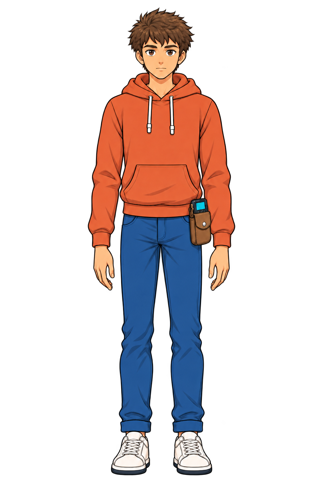
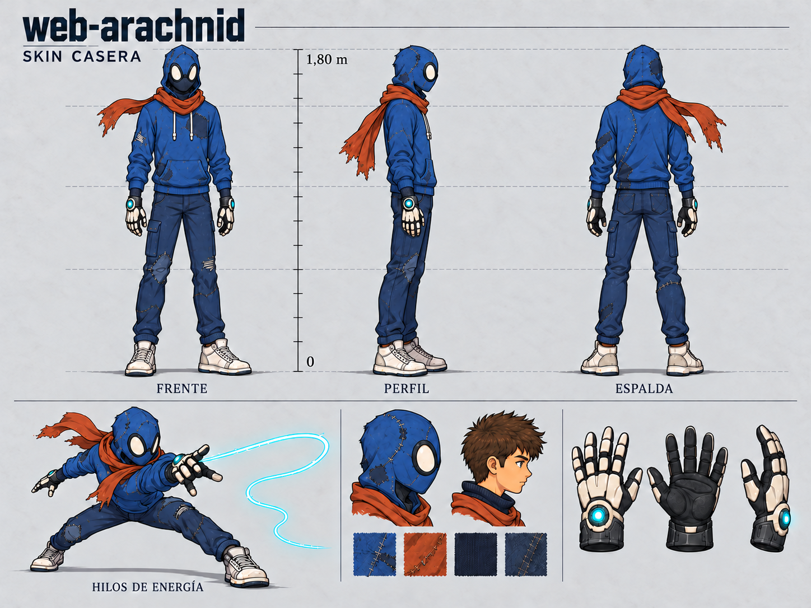
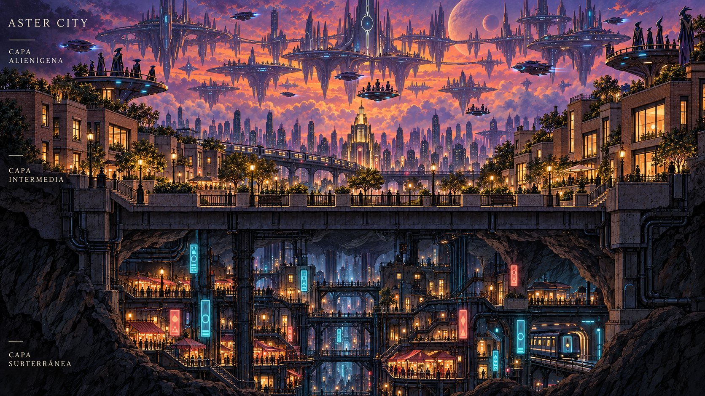

# Arte conceptual de web-arachnid

Abre [index.html](index.html) en un navegador para explorar la galería. Funciona directamente desde el archivo, sin instalar dependencias ni iniciar un servidor. Incluye búsqueda, filtros por tema y versión, vista ampliada, tamaño real y descarga, comparación de altura de Bruce, ficha de proporciones y lectura de las ideas y ambos README. En la vista ampliada, usa las flechas del teclado para recorrer las imágenes y Esc para cerrar.

## Organización de la carpeta

| Carpeta | Contenido |
| --- | --- |
| [assets/characters/bruce/](assets/characters/bruce/README.md) | Bruce y sus ocho variantes: arte, medidas y referencias de modelado juntos. |
| [assets/menus/](assets/menus/) | Concepto del menú principal del juego. |
| [assets/equipment/](assets/equipment/) | Guantes y habilidades. |
| [assets/environments/](assets/environments/) | Aster City y sus tres capas. |
| [assets/story/](assets/story/) | Origen y desarrollo de los guantes. |
| [assets/archive/](assets/archive/) | Versiones anteriores, separadas por los mismos temas. |
| [prompts/](prompts/) | Instrucciones de generación; las antiguas están en `prompts/archive/`. |
| [scripts/](scripts/) | Herramientas auxiliares y actualización de los datos de la galería. |

`manifest.json` es el catálogo de las 73 imágenes: 35 vigentes y 38 anteriores (62 PNG y once guías SVG). `gallery-data.js` se genera desde ese catálogo para que la página funcione también al abrirla como archivo local. Las ideas y ambos README también se incorporan a los datos de la página. Las medidas maestras se guardan en `bruce-proportions.json`. Después de cambiarlas, ejecutar `python3 scripts/build_character_spec.py` para regenerar ficha, ideas, maniquí y prompt, y luego actualizar la galería. Después de cambiar las referencias para modelado 3D, ejecutar `python3 scripts/build_scale_reference.py` para renovar la guía de altura. Después de cambiar las vistas de los trajes, ejecutar `python3 scripts/build_suit_scale_references.py` para renovar sus seis láminas. Después de cambiar el catálogo o los documentos, ejecutar `python3 scripts/build_gallery_data.py` desde esta carpeta.

Revisión del 12 de octubre de 2026 basada en [ideas.md](../ideas.md). Las imágenes de esta página son las referencias vigentes. Se conserva el arte anterior para comparar la evolución del diseño.

Los nombres de carpetas y archivos están en inglés; los rótulos de la página y los documentos permanecen en español. [file-renames.json](file-renames.json) registra los cambios de rutas.

## Carpetas por variante de Bruce

Cada carpeta incluye el PNG de arte conceptual, un SVG de escala y `modeling-references/` con imágenes para crear el modelo 3D. La denominación no depende de Meshy ni de otra herramienta.

| Variante | Carpeta |
| --- | --- |
| Bruce sin guantes | [assets/characters/bruce/civilian/](assets/characters/bruce/civilian/README.md) |
| Bruce con guantes | [assets/characters/bruce/civilian-with-gloves/](assets/characters/bruce/civilian-with-gloves/README.md) |
| Traje casero | [assets/characters/bruce/homemade-suit/](assets/characters/bruce/homemade-suit/README.md) |
| Traje normal | [assets/characters/bruce/standard-suit/](assets/characters/bruce/standard-suit/README.md) |
| Traje alienígena | [assets/characters/bruce/alien-suit/](assets/characters/bruce/alien-suit/README.md) |
| Traje neón | [assets/characters/bruce/neon-suit/](assets/characters/bruce/neon-suit/README.md) |
| Traje roquero | [assets/characters/bruce/rocker-suit/](assets/characters/bruce/rocker-suit/README.md) |
| Traje cómic | [assets/characters/bruce/comic-suit/](assets/characters/bruce/comic-suit/README.md) |

El maniquí común se guarda en `assets/characters/bruce/body-reference/`. Las referencias sin guantes son cuatro PNG separados. Los seis trajes y Bruce con guantes tienen un PNG `turnaround` con las cuatro vistas; el SVG usa esas mismas figuras para comparar la escala.

Las láminas con y sin guantes se han revisado con las proporciones v3. Las cotas se concentran en los SVG; las láminas de poses y detalles conservan espacio para estudiar el diseño.

## Bruce para modelado 3D: proporciones revisadas

El conjunto `v3` ajusta brazos, manos y la posición de las rodillas hacia las medidas maestras de Bruce, además de mantener la altura total de **1,80 m**. Conserva rostro, pelo castaño, sudadera naranja, jeans azules, zapatillas claras y un único bolso en la cadera izquierda.

| Vista | Archivo vigente |
| --- | --- |
| Frente | [bruce-front-v3.png](assets/characters/bruce/civilian/modeling-references/bruce-front-v3.png) |
| Perfil izquierdo, mirando a la derecha | [bruce-left-v3.png](assets/characters/bruce/civilian/modeling-references/bruce-left-v3.png) |
| Perfil derecho, mirando a la izquierda | [bruce-right-v3.png](assets/characters/bruce/civilian/modeling-references/bruce-right-v3.png) |
| Espalda | [bruce-back-v3.png](assets/characters/bruce/civilian/modeling-references/bruce-back-v3.png) |
| Escala y alturas objetivo de articulaciones | [bruce-scale-180cm.svg](assets/characters/bruce/civilian/bruce-scale-180cm.svg) |

Las cuatro vistas son PNG con transparencia. La comparación alinea su silueta entre las suelas y la parte superior de la cabeza. Las líneas cian muestran las alturas objetivo de hombros, codos, caderas, muñecas, dedos y rodillas. Estas ilustraciones permiten comparar las proporciones visualmente; las medidas exactas gobiernan el maniquí y el futuro modelo 3D.

Las seis vistas `v2`, incluidos los ángulos alto y bajo, se conservan en `assets/archive/modeling-references/` y no gobiernan las proporciones actuales. Los scripts de reconstrucción anteriores siguen asociados a imágenes antiguas.

## Medidas maestras del cuerpo

La [ficha de proporciones](bruce-proportions.md) define las medidas objetivo de Bruce: brazo superior de 32 cm, antebrazo de 26 cm, mano de 18 cm, muslo de 46 cm y rodilla a tobillo de 41 cm. Incluye anchos y alturas de articulaciones desde el suelo. El torso, cuello, cabeza y piernas suman exactamente 180 cm.

[La lámina de construcción](assets/characters/bruce/body-reference/bruce-proportions-180cm.svg) distingue el maniquí de medidas de la referencia visual. Usar el maniquí para dimensiones y las vistas de modelado 3D para rostro, pelo, ropa e identidad. Las ilustraciones existentes deben comprobarse con estas cotas; para vistas idénticas, generar todas desde un único modelo 3D.

## Láminas de escala de los seis trajes

Cada traje tiene el mismo formato que Bruce: fondo claro, cuatro vistas, suelas alineadas a 0 cm y parte superior de la silueta a 1,80 m. Las líneas cian marcan las alturas objetivo de hombros, codos, caderas, muñecas, dedos y rodillas.

| Traje | Lámina |
| --- | --- |
| Casero | [suit-homemade-scale-180cm.svg](assets/characters/bruce/homemade-suit/suit-homemade-scale-180cm.svg) |
| Normal | [suit-standard-scale-180cm.svg](assets/characters/bruce/standard-suit/suit-standard-scale-180cm.svg) |
| Alienígena | [suit-alien-scale-180cm.svg](assets/characters/bruce/alien-suit/suit-alien-scale-180cm.svg) |
| Neón | [suit-neon-scale-180cm.svg](assets/characters/bruce/neon-suit/suit-neon-scale-180cm.svg) |
| Roquero | [suit-rocker-scale-180cm.svg](assets/characters/bruce/rocker-suit/suit-rocker-scale-180cm.svg) |
| Cómic | [suit-comic-scale-180cm.svg](assets/characters/bruce/comic-suit/suit-comic-scale-180cm.svg) |

[Ver las seis láminas en la galería](index.html#tema=trajes&buscar=medidas). Los PNG `suit-*-turnaround.png` contienen las cuatro vistas ilustradas que alimentan estas guías. El SVG normaliza la altura de cada silueta y dibuja las cotas desde `bruce-proportions.json`; no modifica las medidas del cuerpo automáticamente. Las cotas son objetivos de construcción para contrastar el dibujo y el modelo 3D.

Las nuevas vistas se generaron con la herramienta integrada. Los prompts y correcciones están en `prompts/suit-*-turnaround*.prompt.txt`. Las láminas de materiales y detalles están en la carpeta de cada traje, junto a su SVG y sus `modeling-references/`.

## Personaje, guantes y skins

| Lámina | Archivo vigente | Qué muestra |
| --- | --- | --- |
| Bruce sin guantes | [bruce-without-gloves-v2.png](assets/characters/bruce/civilian/bruce-without-gloves-v2.png) | Rostro y proporciones revisadas con las vistas v3; reposo, inventor y caminar. |
| Bruce con guantes | [bruce-with-gloves-v3.png](assets/characters/bruce/civilian-with-gloves/bruce-with-gloves-v3.png) | Ropa cotidiana, proporciones revisadas, hilos de energía y escudo. |
| Guantes | [assets/equipment/gloves-v2.png](assets/equipment/gloves-v2.png) | Diseño independiente, hilos, escudo, núcleo y nanobots formando una manga. |
| Skin casera | [assets/characters/bruce/homemade-suit/suit-homemade.png](assets/characters/bruce/homemade-suit/suit-homemade.png) | Primer traje de ropa vieja, costuras, azul, bufanda y cuello de tela. |
| Skin normal | [assets/characters/bruce/standard-suit/suit-standard.png](assets/characters/bruce/standard-suit/suit-standard.png) | Evolución tecnológica del traje, hilos y formación con nanobots. |
| Skin alienígena | [assets/characters/bruce/alien-suit/suit-alien.png](assets/characters/bruce/alien-suit/suit-alien.png) | Apariencia alienígena adaptada al héroe, con los mismos guantes. |
| Skin neón | [suit-neon-v4.png](assets/characters/bruce/neon-suit/suit-neon-v4.png) | Pecho limpio, azul oscuro y luces cian y magenta en el contorno del traje. |
| Skin roquera | [suit-rocker-v2.png](assets/characters/bruce/rocker-suit/suit-rocker-v2.png) | Chaqueta de cuero, tachuelas, bufanda y pelo castaño puntiagudo visible sobre la máscara. |
| Skin cómic | [suit-comic-v3.png](assets/characters/bruce/comic-suit/suit-comic-v3.png) | Estructura del traje normal con tinta gruesa, sombras negras planas y puntos de impresión pronunciados. |
| Origen | [assets/story/bruce-origin-one-year.png](assets/story/bruce-origin-one-year.png) | Invasión vista desde el taller, un año de desarrollo y guantes terminados. |

Los guantes conservan sus placas claras, articulaciones oscuras y núcleos cian, y destacan con todas las skins. El azul y el contraste del traje casero proceden de las ideas; la bufanda naranja y los detalles violetas de la skin alienígena son propuestas visuales de estas láminas.

La skin cómic utiliza el mismo diseño del traje normal: máscara, paneles, azul predominante y zonas oscuras, con tratamiento de tinta y halftone. Sus versiones anteriores se conservan en el archivo. El acabado actual refuerza los contornos, sombras planas, tramas de puntos y líneas de acción.

La skin neón deja el pecho limpio, sin araña ni emblema central. Mantiene el traje oscuro, las luces cian y magenta en hombros, brazos, costados y piernas, y los guantes de Bruce. Las propuestas anteriores se conservan en el archivo.

## Menú principal

[La propuesta del menú](assets/menus/main-menu.png) presenta las tres capas de Aster City, a web-arachnid con su traje normal y las opciones Nueva partida, Continuar, Trajes, Opciones y Salir. La selección usa cian. Es una lámina de interfaz para orientar el diseño del juego.

## Aster City: tres capas verticales

| Lámina | Archivo vigente | Criterio |
| --- | --- | --- |
| Ciudad completa | [assets/environments/aster-city-three-layers.png](assets/environments/aster-city-three-layers.png) | Capas apiladas en vertical: subterránea, intermedia y alienígena. |
| Capa subterránea | [assets/environments/aster-city-under-v2.png](assets/environments/aster-city-under-v2.png) | Barrio pobre con neón bajo un techo de roca y estructuras de soporte. |
| Capa intermedia | [assets/environments/aster-city-rich-v2.png](assets/environments/aster-city-rich-v2.png) | Zona rica, construcciones minimalistas de ladrillo y espacios amplios. |
| Capa alienígena | [assets/environments/aster-city-alien-01-panorama.png](assets/environments/aster-city-alien-01-panorama.png) | Ciudad en el cielo, solo alienígenas, plataformas abiertas y naves. |

## Revisión del material anterior

| Material anterior | Resultado de la revisión |
| --- | --- |
| `assets/archive/characters/bruce-without-gloves-before-proportion-update.png` | Archivado al revisar las proporciones con las vistas v3; usar el estudio nuevo en `civilian/`. |
| `assets/archive/characters/bruce-with-gloves.png`, `assets/archive/equipment/gloves.png` | Sustituidos como referencias vigentes por sus versiones v2, que muestran las nuevas habilidades. |
| `assets/archive/suits/first-suit.png` | Su diseño avanzado sirve de base a `assets/characters/bruce/standard-suit/suit-standard.png`. El primer traje ahora es `assets/characters/bruce/homemade-suit/suit-homemade.png`. |
| `assets/archive/environments/aster-city-under-01-panorama.png`, `assets/archive/environments/aster-city-under-02-commercial-street.png`, `assets/archive/environments/aster-city-under-03-rooftops-and-metro.png` | Conservados como exploraciones de ambiente y neón. Su cielo abierto no corresponde a la capa subterránea actual. |
| `assets/archive/environments/aster-city-rich-01-panorama.png`, `assets/archive/environments/aster-city-rich-02-square.png`, `assets/archive/environments/aster-city-rich-03-terraces.png` | Conservados como exploraciones anteriores. La referencia vigente usa arquitectura más simple y ladrillo. |
| `assets/archive/environments/aster-city-connection-panorama.png` | Sustituido como referencia geográfica por la vista de tres capas verticales. |
| `assets/archive/modeling-references/bruce-modeling.png` y las cinco vistas anteriores | Las versiones originales y v2 están archivadas; las cuatro vistas v3 son las referencias actuales. |

## Instrucciones de generación

Se utilizó la herramienta integrada de generación y edición de imágenes. Los prompts completos y las correcciones están guardados en [prompts/](prompts/), con el mismo nombre base que cada lámina. [manifest.json](manifest.json) relaciona archivos, referencias y prompts.

Las láminas de personaje, skins y origen conservan la identidad de Bruce. Las cuatro vistas de modelado 3D v3 son ahora la referencia para revisar las longitudes de brazos y piernas de nuevas ilustraciones. La altura total de Bruce es 1,80 m, desde las suelas hasta la parte superior de la cabeza. Las versiones previas a esta unificación se conservan en `assets/archive/`.

Estas láminas desarrollan visualmente las ideas existentes; los detalles de formas y materiales que todavía no están definidos en `ideas.md` se mantienen como propuestas de diseño.

